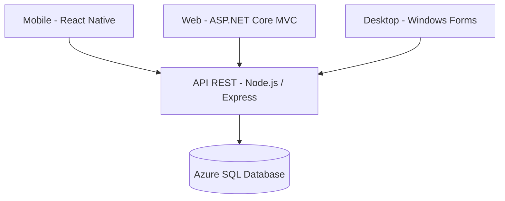

# Plataforma Cursos — PIM IV

Projeto Integrado Multidisciplinar (PIM IV) do curso de Análise e Desenvolvimento de Sistemas da Universidade Paulista (UNIP).

A Plataforma Cursos é um sistema educacional multiplataforma que permite gerenciar cursos, aulas, usuários e matrículas, acompanhar o progresso acadêmico e incentivar o aprendizado por meio da gamificação.

## Funcionalidades

| Perfil | Funcionalidades |
| --- | --- |
| Aluno | Cadastro público, consulta ao catálogo, matrículas, acesso às aulas, acompanhamento do progresso, XP e conquistas. |
| Professor | Gerenciamento dos próprios cursos e aulas, acompanhamento de alunos vinculados e consulta ao ranking. |
| Administrador | Gerenciamento de usuários, cursos e aulas, acompanhamento do progresso e consulta ao ranking. |

O sistema contempla autenticação por JWT, senhas protegidas por hash scrypt, recuperação por código e troca obrigatória da senha temporária no primeiro acesso de contas criadas pelo administrador.

## Arquitetura

As três aplicações foram desenvolvidas para compartilhar uma API REST centralizada e um banco de dados relacional hospedado no Azure. O modo integrado utiliza a API para concentrar as regras de negócio e o controle de acesso.



## Tecnologias

| Componente | Tecnologias |
| --- | --- |
| Mobile | JavaScript, React Native, Expo e Axios |
| Web | C#, ASP.NET Core MVC, Razor e .NET 8 |
| Desktop | C#, Windows Forms e .NET 8 |
| API | Node.js, Express e JWT |
| Banco de dados | SQL Server / Azure SQL Database |
| Hospedagem da API | Render |
| Testes | Node.js Test Runner |

## Estrutura do repositório

```text
PIM-IV/
├── api/       # Backend REST e testes automatizados
├── mobile/    # Aplicativo React Native
├── desktop/   # Aplicação Windows Forms e scripts SQL
├── web/       # Aplicação ASP.NET Core MVC
└── README.md
```

## Como executar

### Pré-requisitos

- Node.js e npm compatíveis com Expo SDK 57;
- SDK .NET 8 e Visual Studio com as cargas de trabalho Desktop .NET e ASP.NET;
- Windows para executar a aplicação Desktop;
- Expo Go compatível ou emulador Android para executar o Mobile.

### Mobile

Na pasta `mobile`, crie um arquivo `.env` com o endereço da API:

```env
EXPO_PUBLIC_API_URL=https://pim-iv-api.onrender.com/api
```

A partir da raiz do repositório:

```bash
cd mobile
npm ci
npx expo start -c
```

Abra o aplicativo em um dispositivo compatível ou emulador.

### Desktop

Abra `desktop/PlataformaCursos.sln` no Visual Studio e selecione o perfil **API (Azure)**. Execute com F5.

### Web

Abra `web/PlataformaCursosWeb.sln` no Visual Studio e selecione o perfil **API (Azure)**, ou execute a partir da raiz:

```bash
dotnet run --project web/PlataformaCursosWeb/PlataformaCursosWeb.csproj --launch-profile "API (Azure)"
```

Acesse o endereço informado no terminal.

### API local (opcional)

Os clientes podem utilizar a API hospedada no Render. Para desenvolver o backend localmente, crie `api/.env` com as configurações do banco autorizado:

```env
PORT=3000
DB_SERVER=seu-servidor.database.windows.net
DB_DATABASE=seu-banco
DB_USER=seu-usuario
DB_PASSWORD=sua-senha
DB_ENCRYPT=true
DB_TRUST_SERVER_CERTIFICATE=false
JWT_SECRET=substitua-por-um-segredo-aleatorio-de-pelo-menos-32-caracteres
```

```bash
cd api
npm ci
npm start
```

O endpoint `/api/health` permite verificar a comunicação com o banco. Para usar a API local, ajuste também os endereços dos clientes. No emulador Android, utilize `http://10.0.2.2:3000/api`.

Não publique arquivos `.env`, senhas ou segredos JWT. Utilize um banco com o esquema e as migrações compatíveis com a API; os scripts locais legados não devem ser executados indiscriminadamente no Azure.

## Testes automatizados

A suíte da API contém **53 testes automatizados**:

| Categoria | Quantidade |
| --- | ---: |
| Segurança e autenticação (unitários) | 16 |
| Permissões (unitários) | 10 |
| Validação de aulas (unitários) | 8 |
| Integração da API | 19 |
| **Total** | **53** |

Na pasta `api`, execute:

```bash
npm ci
npm test
```

Comandos adicionais:

| Comando | Finalidade |
| --- | --- |
| `npm run test:unit` | Executar os 34 testes unitários |
| `npm run test:integration` | Executar os 19 testes de integração |
| `npm run test:report` | Gerar relatório dos testes |

Os testes de integração utilizam um banco simulado. A validação das interfaces e da conexão com o Azure real deve ser realizada separadamente.

## Contexto acadêmico

Projeto desenvolvido para fins acadêmicos, integrando conhecimentos de desenvolvimento mobile, programação orientada a objetos, desenvolvimento web, bancos de dados, engenharia de software e computação em nuvem.

**Universidade Paulista — UNIP | Análise e Desenvolvimento de Sistemas | PIM IV — 2026**
