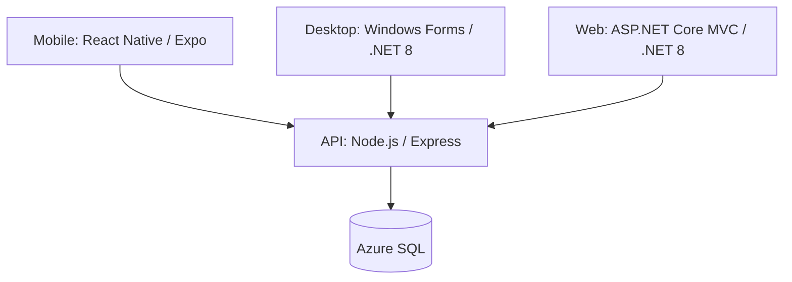

# Plataforma Cursos — PIM IV

Projeto Integrado Multidisciplinar do curso de Análise e Desenvolvimento de Sistemas da Universidade Paulista (UNIP).

Sistema educacional multiplataforma para gestão de cursos, aulas, matrículas, progresso e gamificação. As aplicações compartilham uma API REST e um banco Azure SQL.

## Funcionalidades

| Perfil | Recursos |
|---|---|
| Aluno | Cadastro público, catálogo, matrículas, conteúdo de aulas, progresso e gamificação. |
| Professor | Gestão dos próprios cursos e aulas, acompanhamento dos alunos vinculados e ranking. |
| Administrador | Gestão de usuários, cursos e aulas, acompanhamento de alunos e ranking. |

## Arquitetura



## Estrutura

| Diretório | Finalidade |
|---|---|
| `api/` | API REST, autenticação JWT e testes Node.js |
| `mobile/` | Aplicativo React Native com Expo |
| `desktop/` | Aplicativo Windows Forms |
| `web/` | Aplicação ASP.NET Core MVC |
| `sql/` | Esquema, diagnóstico e migração |
| `docs/` | Documentação técnica |

## Execução rápida

Requisitos: Node.js compatível com Expo 57, npm, SDK .NET 8, Windows para o Desktop e acesso autorizado à API. Para executar o backend localmente, configure também o Azure SQL conforme o [guia de instalação](docs/INSTALACAO.md).

```powershell
# API local (após configurar api/.env)
cd api
npm ci
npm start
```

Em outro terminal, na raiz:

```powershell
cd mobile
npm ci
npx expo start -c
```

Para Desktop e Web, a partir da raiz, use terminais separados:

```powershell
dotnet run --project desktop/PlataformaCursos/PlataformaCursos.csproj --launch-profile "API (Azure)"
dotnet run --project web/PlataformaCursosWeb/PlataformaCursosWeb.csproj --launch-profile "API (Azure)"
```

A API hospedada configurada no projeto é `https://pim-iv-api.onrender.com`. O estado atual do serviço não foi verificado nesta revisão.

## Testes

```powershell
cd api
npm ci
npm test
npm run test:report
```

O relatório entregue na Etapa 8 registra 53 testes aprovados e nenhuma falha, com banco simulado. A homologação real e a compilação das interfaces ainda são necessárias.

## Documentação

- [Instalação, configuração e publicação](docs/INSTALACAO.md)
- [Arquitetura e regras de negócio](docs/ARQUITETURA.md)
- [Referência da API](docs/API.md)
- [Homologação e pendências](docs/HOMOLOGACAO.md)

Projeto desenvolvido para fins acadêmicos — UNIP, ADS, PIM IV.
