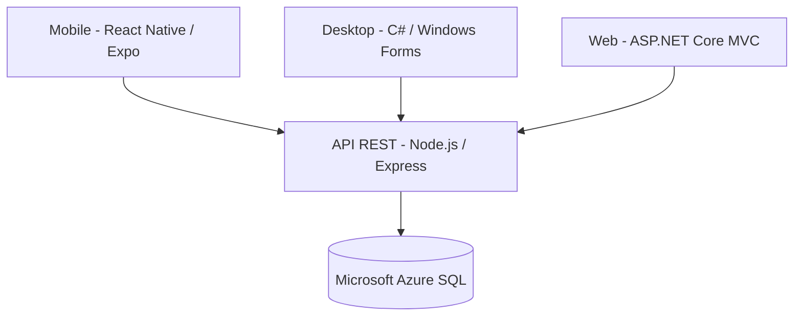

# Plataforma Cursos — PIM IV

Projeto Integrado Multidisciplinar (PIM IV) do curso de Análise e Desenvolvimento de Sistemas da Universidade Paulista (UNIP).

A Plataforma Cursos é um sistema educacional multiplataforma voltado à gestão de cursos, aulas, matrículas e acompanhamento do aprendizado. O projeto reúne aplicações mobile, desktop e web, com uma API REST centralizada e persistência de dados em nuvem.

## Funcionalidades

| Perfil | Funcionalidades |
| --- | --- |
| Aluno | Cadastro, consulta de cursos, matrículas, conclusão de aulas, acompanhamento de progresso e gamificação. |
| Professor | Gestão dos cursos e aulas sob sua responsabilidade e acompanhamento do progresso dos alunos. |
| Administrador | Gerenciamento de usuários, perfis, cursos e aulas. |

O sistema também contempla autenticação, recuperação de senha por código pessoal, experiência (XP), níveis, conquistas e sequência de estudos. A disponibilidade de cada recurso depende do perfil e da aplicação utilizada.

## Arquitetura



A arquitetura integrada utiliza comunicação HTTP/HTTPS e autenticação JWT. A API concentra as regras de negócio e o acesso ao banco de dados, permitindo o compartilhamento de informações entre as aplicações. Desktop e web devem ser executados no modo API para utilizar o ambiente centralizado.

## Tecnologias

| Camada | Tecnologias |
| --- | --- |
| Mobile | JavaScript, React Native, Expo, Axios, React Navigation |
| Desktop | C#, Windows Forms, .NET 8 |
| Web | C#, ASP.NET Core MVC, .NET 8 |
| Backend | Node.js, Express, JWT, mssql |
| Banco de dados | SQL Server, Microsoft Azure SQL |
| Hospedagem da API | Render |
| Testes | Node.js Test Runner (`node:test`) |
| Versionamento | Git e GitHub |

## Estrutura do repositório

```text
PIM-IV/
├── api/       # API REST, regras de negócio e testes
├── mobile/    # Aplicação React Native
├── desktop/   # Aplicação Windows Forms
├── web/       # Aplicação ASP.NET Core MVC
├── sql/       # Scripts de banco de dados
└── README.md
```

## Execução do projeto

### Pré-requisitos

- Git e Node.js 22 LTS (ou versão compatível com o Expo utilizado), com npm.
- SDK .NET 8 e Visual Studio com as cargas de trabalho de desenvolvimento desktop e ASP.NET, para as aplicações C#.
- Windows para a aplicação Windows Forms.
- Expo Go compatível com o SDK do projeto ou emulador Android configurado, para a aplicação mobile.
- SQL Server ou Azure SQL somente para quem for configurar uma instância própria do backend.

Clone o repositório:

```bash
git clone -b deploy-api https://github.com/guilhermeamst/PIM-IV.git
cd PIM-IV
```

### API hospedada

A API está configurada para execução no Render:

- URL base: `https://pim-iv-api.onrender.com`
- Verificação de disponibilidade: [GET /api/health](https://pim-iv-api.onrender.com/api/health)

Para utilizar a API hospedada, não é necessário iniciar o backend localmente nem configurar acesso direto ao banco de dados. A primeira requisição pode demorar caso o serviço esteja inativo.

### Mobile

Na pasta `mobile`, crie um arquivo `.env` com:

```dotenv
EXPO_PUBLIC_API_URL=https://pim-iv-api.onrender.com/api
```

Execute:

```bash
cd mobile
npm ci
npx expo start -c
```

Leia o QR Code com um cliente Expo compatível ou pressione `a` para abrir o emulador Android. Caso não exista arquivo de lock no checkout, utilize `npm install` no lugar de `npm ci`.

### Desktop

Abra `desktop/PlataformaCursos.sln` no Visual Studio, selecione o perfil **API (Azure)** e pressione F5.

Alternativamente, no terminal, a partir da raiz:

```powershell
dotnet run --project desktop/PlataformaCursos/PlataformaCursos.csproj --launch-profile "API (Azure)"
```

O perfil utiliza `API_ATIVA=true` e `API_URL=https://pim-iv-api.onrender.com`.

### Web

Abra `web/PlataformaCursosWeb/Properties/launchSettings.json` e, no perfil `API (Azure)`, confirme as variáveis:

```json
"Api__Ativa": "true",
"Api__UrlBase": "https://pim-iv-api.onrender.com"
```

Abra `web/PlataformaCursosWeb.sln`, selecione **API (Azure)** e pressione F5. Também é possível executar pela raiz:

```powershell
dotnet run --project web/PlataformaCursosWeb/PlataformaCursosWeb.csproj --launch-profile "API (Azure)"
```

Acesse `http://localhost:5000`. A integração web com a API hospedada ainda requer homologação.

### Backend local (opcional)

Crie `api/.env` com os dados de uma instância autorizada de SQL Server/Azure SQL. Exemplo para Azure SQL:

```dotenv
PORT=3000
DB_SERVER=seu-servidor.database.windows.net
DB_DATABASE=PlataformaCursosDB
DB_USER=seu-usuario
DB_PASSWORD=sua-senha
DB_PORT=1433
DB_ENCRYPT=true
DB_TRUST_SERVER_CERTIFICATE=false
JWT_SECRET=substitua-por-uma-chave-aleatoria-forte
```

Os valores acima são exemplos, não credenciais reais. Configure o firewall do Azure para permitir a conexão autorizada.

```bash
cd api
npm ci
npm start
```

A API local estará disponível em `http://localhost:3000/api/health`. Para utilizá-la, ajuste as URLs dos clientes (no emulador Android, utilize `http://10.0.2.2:3000/api`; no celular físico, utilize o IP acessível do computador).

## Banco de dados

O ambiente integrado utiliza o banco `PlataformaCursosDB`, hospedado no Azure SQL. As principais entidades são:

- `Usuarios`, `Cursos`, `Aulas`, `Matriculas` e `Progresso`;
- `Gamificacao`, `Conquistas`, `UsuarioConquistas` e `HistoricoXP`;
- `CodigosRecuperacao`.

Os scripts estão em `sql/`. O arquivo `CursosDB.sql` foi originalmente preparado para SQL Server local. Para Azure SQL, conecte-se diretamente ao banco de destino e adapte os comandos de criação/seleção de banco. A tabela `CodigosRecuperacao` também deve estar presente; sua migração precisa ser preservada ou incorporada ao script principal. Não execute scripts de inicialização no ambiente existente sem revisar seus efeitos.

## Segurança

- Autenticação por tokens JWT com expiração.
- Controle de acesso por perfil nas rotas protegidas.
- Senhas novas armazenadas com scrypt e salt aleatório individual.
- Códigos de recuperação armazenados como hash SHA-256, com limitação de tentativas.
- Consultas parametrizadas nas operações de autenticação e cadastro.
- Credenciais e chaves configuradas por variáveis de ambiente.

Contas legadas podem utilizar o formato anterior de senha e devem ser migradas para hash. Não publique arquivos `.env`, senhas ou chaves no repositório.

## Testes automatizados

Após aplicar o pacote de testes ao diretório `api`, execute:

```bash
cd api
npm ci
npm test
```

| Comando | Finalidade |
| --- | --- |
| `npm run test:unit` | Testes unitários de permissões, validação de cadastro, senhas e códigos de recuperação. |
| `npm run test:integration` | Testes de integração da API com banco simulado. |
| `npm run test:report` | Execução dos testes e geração de relatório HTML. |

O relatório é salvo em `api/reports/testes.html`. Os testes com banco simulado não substituem a homologação com Azure SQL nem os testes de interface das aplicações.

## Situação da integração

- Mobile e desktop: login e cadastro validados no ambiente integrado.
- API e Azure SQL: comunicação validada.
- Web: homologação pendente.
- Testes automatizados: suíte preparada; execução completa no ambiente do grupo pendente de confirmação.

## Contexto acadêmico

O projeto aplica conhecimentos de desenvolvimento multiplataforma, programação orientada a objetos, banco de dados relacional, integração de sistemas, segurança, computação em nuvem e qualidade de software.

Desenvolvido para fins acadêmicos pelos integrantes do PIM IV de Análise e Desenvolvimento de Sistemas — UNIP.

## Revisao integrada de autenticacao

- Mobile, Desktop e Web usam a API hospedada por padrao. O cadastro publico permanece no Mobile; o painel administrativo cria contas nos tres clientes.
- Recuperacao usa codigo pessoal de 16 caracteres; a API rotaciona o codigo ao redefinir a senha. O administrador entrega o codigo inicial de forma privada.
- Configure JWT_SECRET no Render com pelo menos 32 caracteres aleatorios antes do deploy. Alterar a chave invalida tokens existentes.
- Senhas legadas em texto puro sao convertidas para scrypt no login bem-sucedido. Contas antigas sem codigo ainda precisam de procedimento de recuperacao assistida.
- Execute sql/Etapa5_RecuperacaoCodigo.sql conectado ao banco correto; se a tabela tiver formato legado, o script interrompe sem apagar dados.
- O modo SQL legado permanece no codigo C# e nao deve ser usado no ambiente integrado.
- Validacao: 41 testes Node com banco simulado; compilacao e testes de interface C# e Android ainda necessarios.
